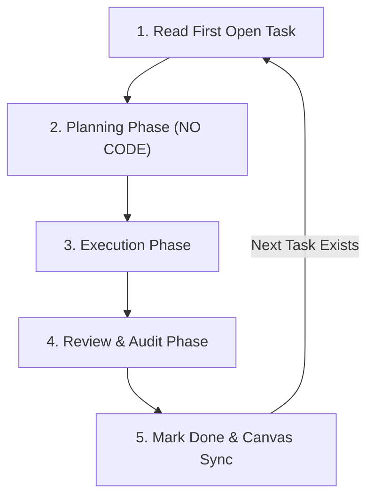

# Todo + Obsidian + Automated Task Execution Workflow

## Files (always both)

| File | Role |
|------|------|
| `docs/ROADMAP.md` | **Source of truth** — checkboxes `- [ ]` / `- [x]` |
| `obsidian/FriendsBattery/Role Chain Workflow.canvas` | Visual in Obsidian — must match ROADMAP |
| `obsidian/FriendsBattery/Role Chain Workflow.md` | Optional mermaid note — update **Next** line on sync |

Never invent a second todo list. Edit ROADMAP first, then sync canvas.

**Role chain:** `SUPER ADMIN → ADMIN → SELLER → EMPLOYEE`  
Order: `§0 → §1 → §2 → §3 → §4 → §5 → §6` (Optional last).

---

## Commands

| Say | Do |
|-----|-----|
| `/todo` | Overview table from ROADMAP + **Next up** + remind canvas path |
| `/todo run` | **Auto-run task execution loop** (plan → execute → audit → mark done → next) |
| `/todo <n\|name>` | Print that ROADMAP section |
| `/todo next` | First incomplete section + open boxes |
| `/todo-add <text>` | Append `- [ ]` in right § → **sync canvas** |
| `/todo-done <n\|text>` | `- [ ]` → `- [x]` → **sync canvas** |
| `/todo-undone <n\|text>` | `- [x]` → `- [ ]` → **sync canvas** |
| `/todo-sync` | Rebuild canvas status from ROADMAP only (no ROADMAP edit) |

Ambiguous match → one short question.

---

## Automated Task Execution Loop (`/todo run` or auto task mode)

When a task exists or `/todo run` is invoked, execute each open task `- [ ]` in `docs/ROADMAP.md` following this strict 5-step loop:



### Step 1: Read First Task
- Read `docs/ROADMAP.md` and find the first incomplete item (`- [ ]`).

### Step 2: Planning Phase (DO NOT CODE YET)
- State assumptions and create a concise step-by-step implementation plan.
- **Apply `/karpathy-guidelines`**: "Think Before Coding" — surface hidden confusion, tradeoffs, and ask if ambiguous.
- **Apply `/ponytail`**: "Simplicity First" — enforce YAGNI, check standard library/existing code first, reject over-engineering before writing any code.

### Step 3: Execution Phase
- Execute the planned task following [AGENTS.md](file:///c:/Users/DELL/dev/friendsBattery/AGENTS.md) and required docs under `docs/` (`docs/architecture.md`, `docs/OPENAPI.md`, `docs/frontend-guidelines.md`).
- Apply **Surgical Changes**: touch ONLY lines relevant to the task; do not refactor adjacent code.

### Step 4: Quality & Over-engineering Audit (Review Phase)
- Review the implemented code to eliminate AI slop, bloated abstractions, and dead code:
  - Run [`/ponytail-review`](file:///c:/Users/DELL/dev/friendsBattery/.agents/skills/ponytail-review/SKILL.md) / [`/ponytail-gain`](file:///c:/Users/DELL/dev/friendsBattery/.agents/skills/ponytail-gain/SKILL.md) to check for over-engineering.
  - Verify that the code satisfies the success criteria.
  - Run build/test verification commands (`npm run dev`, `flutter pub get`, etc.).

### Step 5: Mark Complete & Loop Next
- Mark item as done (`- [x]`) in `docs/ROADMAP.md`.
- Run `/todo-sync` to update the Obsidian canvas.
- Move immediately to the next open task in `docs/ROADMAP.md` and repeat Steps 1–5.

---

## Placement (`/todo-add`)

| Sounds like | § | Canvas node `id` |
|-------------|---|------------------|
| roles, requireRole, four roles | **0** | `sec_0` |
| super admin, all WH, stock any WH | **1** | `sec_1` |
| shop admin, own shop, add shop | **2** | `sec_2` |
| seller re-scope | **3** | `sec_3` |
| employee bill, check-in | **4** | `sec_4` |
| WhatsApp, print, OTP, scrap, service, rent | **5** | `sec_5` |
| e2e, harden, smoke, GPS only when checked in | **6** | `sec_6` |
| optional / later | Optional | `sec_opt` |

After add: say `§N` + line + “canvas synced”.

---

## Done / not done

### `/todo-done`
1. In `docs/ROADMAP.md`: flip matching open items to `- [x]`.  
   - `/todo-done 1` → all open boxes under `## 1.`  
   - `/todo-done employee create bill` → match text  
2. **Archiving Completed Work:**  
   - When a section (e.g. `## 1. Super Admin`) or batch of tasks is fully completed, archive it to `docs/completed_tasks.md`.  
   - Append to `docs/completed_tasks.md` with incremental task numbering (`#1`, `#2`, …) and completion date (e.g. `2026-08-12`).  
   - Replace the completed section/items in `docs/ROADMAP.md` with a clean summary or reference to `docs/completed_tasks.md` to prevent `ROADMAP.md` from growing too large.  
3. Run **canvas sync** (below).  
4. Confirm what flipped, archived items, and section status (NOT DONE / PARTIAL / DONE).


### `/todo-undone`
Same, reverse: `- [x]` → `- [ ]`, then sync.

---

## Canvas sync (required after every ROADMAP change)

**Path:** `obsidian/FriendsBattery/Role Chain Workflow.canvas`  
Stable node ids: `title`, `sec_0` … `sec_6`, `sec_done`, `sec_opt`, `flow`, `build`, `legend`.

### Per section node (`sec_N`)

1. Read ROADMAP section checkboxes (ignore tables).  
2. Count open / done.  
3. Rewrite node `text` as:

```markdown
## §N Title
**Status: NOT DONE|PARTIAL|DONE** (done/total)

☐ item still open
☑ item done
```

Map: `- [ ]` → `☐` · `- [x]` → `☑`  
Use short item text (same meaning as ROADMAP).

4. Set node `color` by status:
   - **NOT DONE** (done=0) → `"1"` (red)
   - **PARTIAL** → `"3"` (yellow)
   - **DONE** (all done, total>0) → `"4"` (green)

### `title` node

```markdown
# Role chain & workflow
`SUPER ADMIN → ADMIN → SELLER → EMPLOYEE`
Source: `docs/ROADMAP.md` · `/todo` · `/todo-sync`
**Next:** §N Title   ← first section with any open box (0–6, else Optional)
Status: ☐ not done · ☑ done
```

### `sec_done`

Baseline “Already done” from ROADMAP — always DONE / green `"4"`.

### No inner scroll (critical)

Obsidian cards **scroll inside** if text taller than `height`. Always:
- Short lines (one todo per line, blank line between todos)
- `height` ≥ ~50 + 36 × (line count including blanks/title)
- Prefer split nodes (`sec_5a` / `sec_5b` / `sec_5c`) over one tall wall of text
- After rewriting `text`, if lines increased, **increase `height`** — never shrink height below content

### Keep fixed

Do **not** shrink heights. Only grow height when content grows.  
Update `text` + `color` (+ `height` if needed). Keep edges.

### Companion md (light)

On sync, set **Next** in `Role Chain Workflow.md` to match title next-up (one line). Don’t rewrite whole file unless broken.

### If canvas missing

Recreate from ROADMAP using current layout (role row §0–4, §5–6 + optional, edges §0→…→§4→§5→§6).

---

## `/todo` overview format

| # | Section | Open | Done | Status |
|---|---------|------|------|--------|
| 0 | Roles foundation | … | … | … |

**Next up:** …  
**Canvas:** `obsidian/FriendsBattery/Role Chain Workflow.canvas`

---

## Hygiene

- ROADMAP is source of truth; canvas is a view.  
- Always sync canvas after add/done/undone.  
- Short replies; no full ROADMAP dump on `/todo`.  
- Don’t reorder role chain.  
