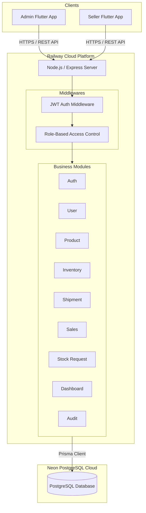
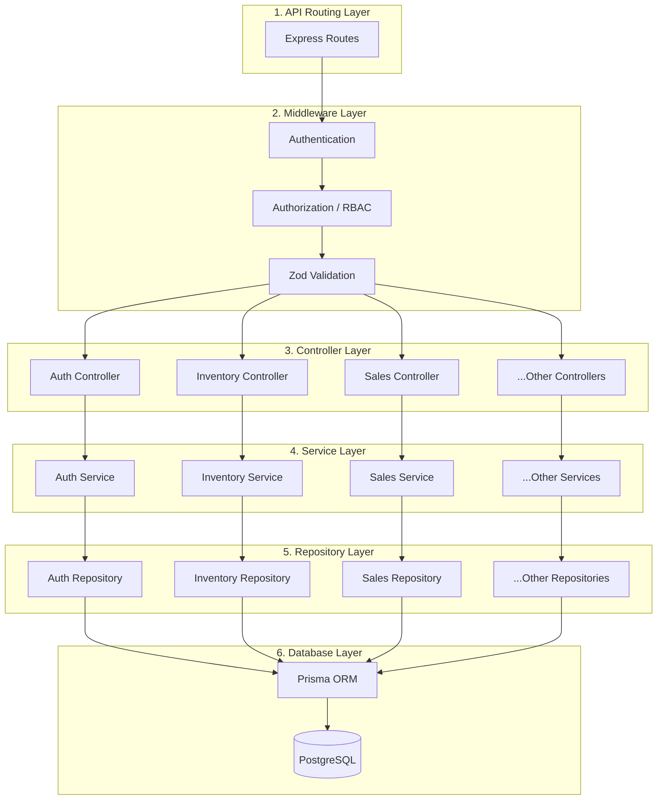
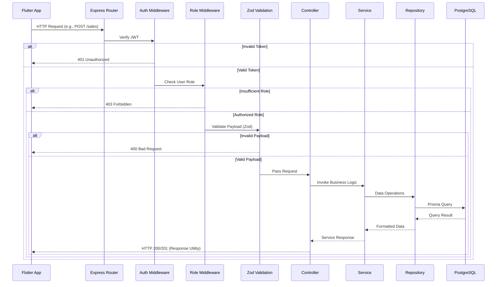
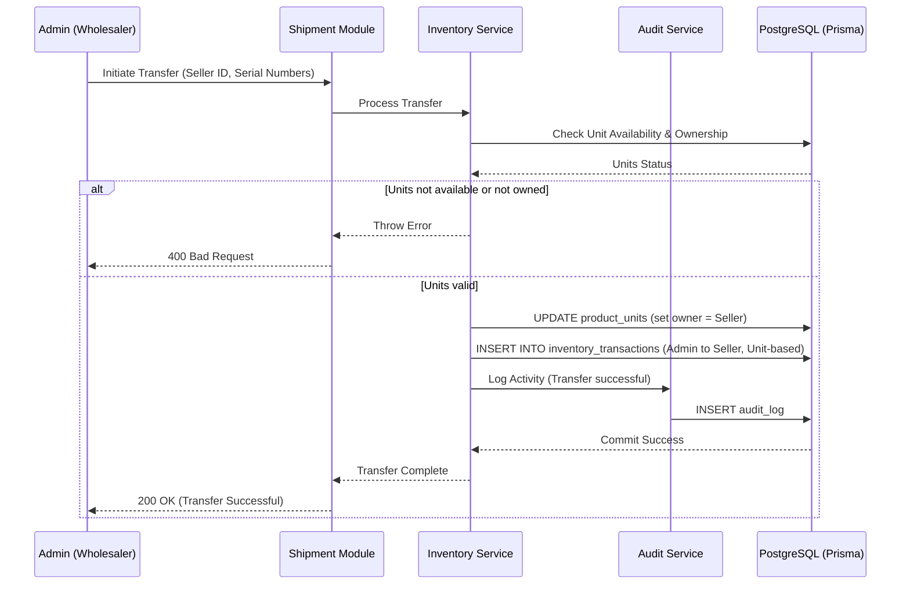
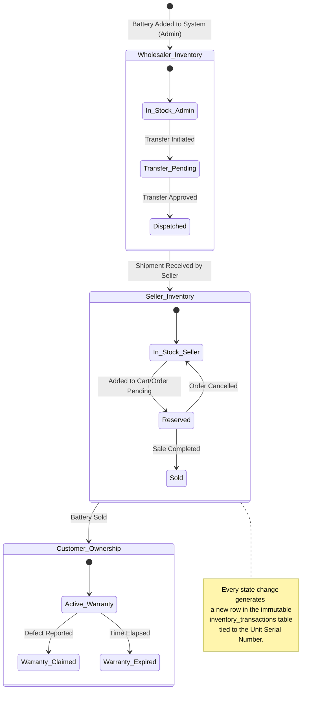

# Friends Battery Backend Architecture

This document contains the architectural diagrams for the Friends Battery inventory and sales management application, designed for scalability and strict inventory traceability.

## 1. High-Level System Architecture Diagram

## 2. Backend Internal Architecture Diagram

## 3. Request Flow Diagram

## 4. Inventory Transfer Flow Diagram

## 5. Battery Traceability Flow Diagram

