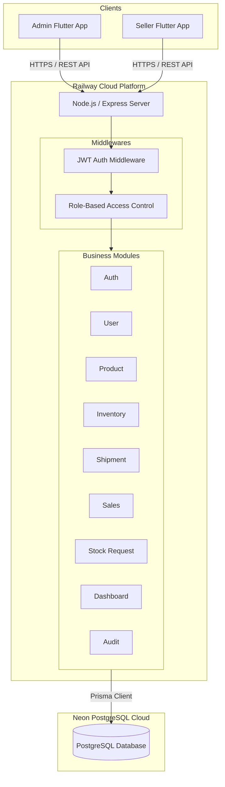
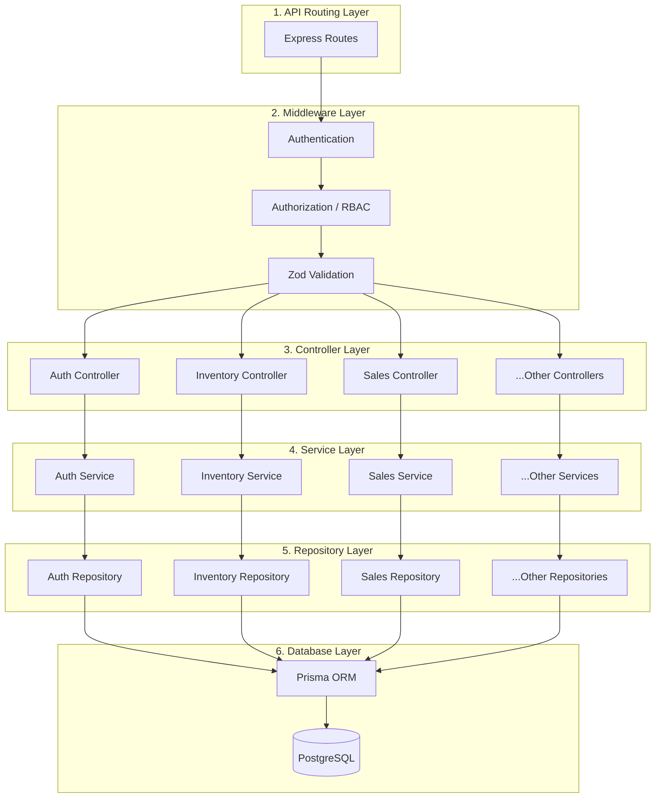
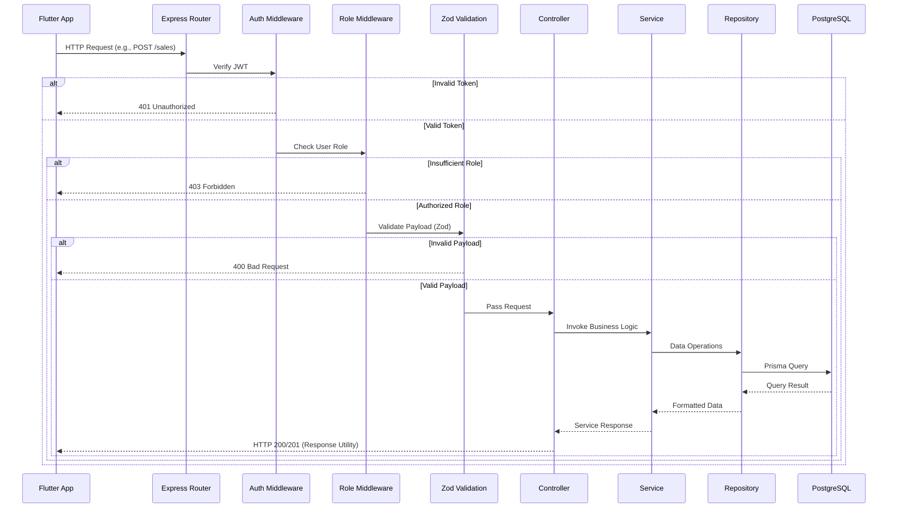
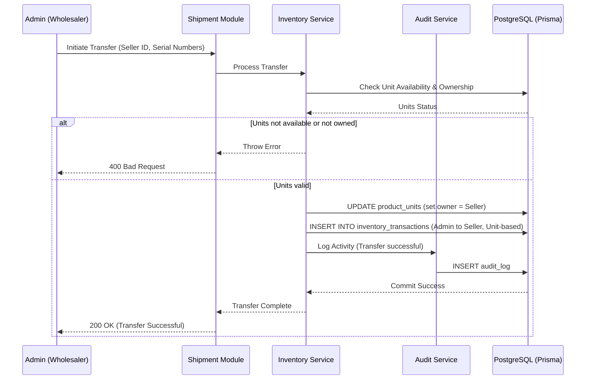
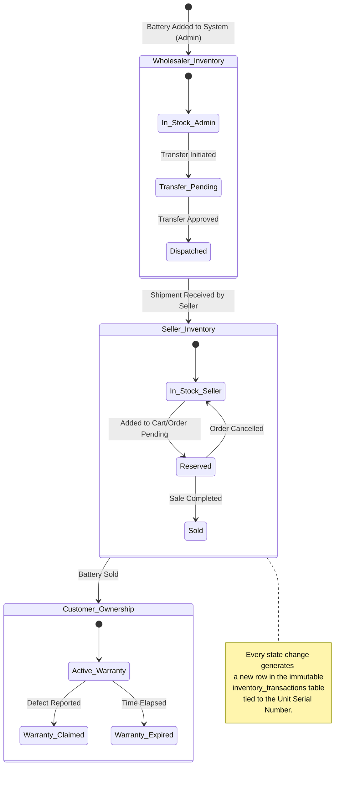

# Friends Battery Backend Architecture & Guidelines

This document is the source of truth for backend implementation, containing both the architectural diagrams and coding guidelines. All developers and AI agents must follow these guidelines. Do not introduce new architectural patterns without updating this document.

---

## Part 1: Architecture Diagrams

### 1. High-Level System Architecture Diagram

### 2. Backend Internal Architecture Diagram

### 3. Request Flow Diagram

### 4. Inventory Transfer Flow Diagram

### 5. Battery Traceability Flow Diagram

---

## Part 2: Architecture Guidelines

### Architecture Flow

Every request must follow:

Route
→ Authentication Middleware
→ Authorization Middleware
→ Validation Middleware
→ Controller
→ Service
→ Repository
→ Prisma
→ PostgreSQL

Never bypass layers.

Controllers must never access Prisma directly.

Services must never access Express request/response objects.

Repositories are the only layer allowed to access Prisma.

---

### Folder Structure

src/

routes/
controllers/
services/
repositories/
models/
validators/
middleware/
utils/
config/

---

### Authentication

Authentication is mandatory for all protected APIs.

Login returns:

{
"auth_id": "",
"auth_key": ""
}

Authentication middleware must:

1. Verify auth_id exists.
2. Verify auth_key is valid.
3. Load authenticated user.
4. Attach user information to request.

Example:

req.user = {
id,
role,
shop_id
}

Never trust values sent from frontend.

Always use authenticated user data from middleware.

---

### Authorization

Authorization is mandatory.

Every protected API must verify permissions.

Roles:

ADMIN
SELLER

Rules:

ADMIN:

* Access all data
* Manage sellers
* Manage inventory
* Approve requests

SELLER:

* Access only own data
* Access only own inventory
* Access only own sales
* Create stock requests

A seller must never access another seller's data.

Always enforce ownership validation.

Never skip authorization.

---

### Validation

Use Zod for validation.

Every API must have:

Request Schema
Response Schema

Validation must execute before controller.

Never trust frontend payloads.

---

### API Response Format

Success:

{
"success": true,
"message": "",
"data": {}
}

Error:

{
"success": false,
"message": "",
"error_code": ""
}

All APIs must use the same format.

---

### Controller Rules

Controllers are thin.

Responsibilities:

* Receive request
* Call service
* Return response

Controllers must not:

* Write business logic
* Access database
* Contain calculations

Bad:

Controller
→ Prisma

Good:

Controller
→ Service

---

### Service Rules

Services contain business logic.

Examples:

* Transfer inventory
* Create sale
* Approve stock request

Services may call multiple repositories.

Services must not call other module models directly.

Services should reuse existing services when appropriate.

Before creating a new function:

1. Check if implementation already exists.
2. Reuse existing logic.
3. Avoid duplicate business logic.

---

### Repository Rules

Repositories handle database access.

Responsibilities:

* Prisma queries
* Data retrieval
* Data persistence

Repositories must not contain business logic.

Bad:

InventoryRepository:

* Check permissions
* Calculate stock

Good:

InventoryRepository:

* findInventory()
* updateInventory()
* createInventory()

---

### Model Rules

Separate models properly.

Request Models

Example:

CreateSaleRequest

Response Models

Example:

CreateSaleResponse

Domain Models

Example:

SaleModel

Do not mix request and response models.

Do not reuse unrelated models between modules.

Use Generic API Models.

Example:

ApiResponse<T>

PaginatedResponse<T>

---

### Inventory Rules

Current MVP:

Quantity Based Inventory

Example:

Battery Type A = 100

Future:

Serial Number Based Inventory

Architecture must support future migration.

Do not hardcode quantity-only assumptions.

---

### Soft Delete Rules

Never permanently delete records.

Use:

is_deleted = true

or

deleted_at timestamp

All queries must exclude deleted records by default.

---

### Audit Logging

Automatically create audit logs for:

* Login
* User Creation
* Inventory Transfer
* Sale Creation
* Stock Request Creation
* Stock Request Approval
* Inventory Adjustment

Audit logs must never be skipped.

---

### Reusability Rules

Before creating:

* Repository
* Service
* Validator
* Utility

Check existing implementation.

Reuse existing code whenever possible.

Avoid duplicate functions.

Avoid duplicate queries.

Avoid duplicate validators.

---

### Security Rules

Never expose passwords.

Never expose internal IDs unnecessarily.

Never trust frontend role values.

Never trust frontend ownership values.

Always validate authenticated user.

Always verify seller ownership.

Always verify permissions.

Authentication and authorization are mandatory.

Never skip them.

---

### AI Agent Instructions

Before generating code:

1. Read this file.
2. Follow architecture exactly.
3. Reuse existing modules where possible.
4. Do not introduce new patterns.
5. Do not bypass middleware.
6. Do not bypass repositories.
7. Do not skip authentication.
8. Do not skip authorization.
9. Do not duplicate logic.
10. Maintain consistency across modules.
