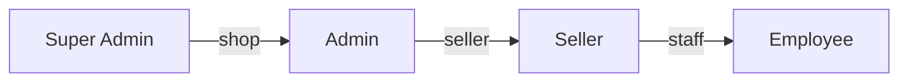
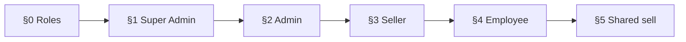
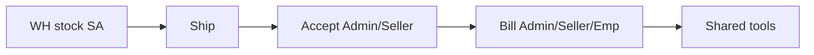

# Role chain workflow

**Canvas (open this in Obsidian):** [[Role Chain Workflow]]  
**Todos:** `docs/ROADMAP.md` · commands: `/todo` · `/todo-done` · `/todo-undone` · `/todo-sync`

**Next:** §1 Super Admin

## Chain

```text
SUPER ADMIN → ADMIN → SELLER → EMPLOYEE
```



## Status on canvas

| Color | Meaning |
|-------|---------|
| Red | NOT DONE (0 done) |
| Yellow | PARTIAL |
| Green | DONE |

- `☐` = not done · `☑` = done  
- After any `/todo-done` or `/todo-undone`, canvas is re-synced from ROADMAP  

## Build order



## Stock flow


