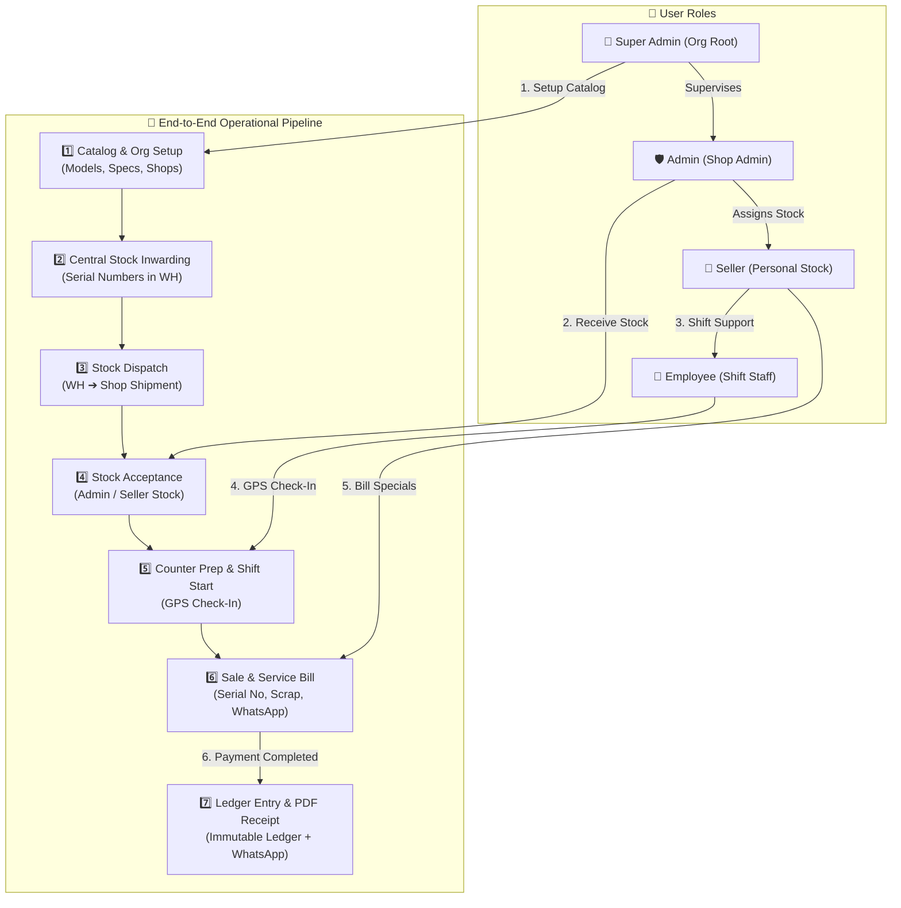

# User Roles & Operational Flowchart

**Hierarchy Chain:** `SUPER_ADMIN ➔ ADMIN ➔ SELLER ➔ EMPLOYEE`

Visual Obsidian Canvas: [User Roles & Capabilities Flow.canvas](file:///c:/Users/DELL/dev/friendsBattery/obsidian/FriendsBattery/User%20Roles%20%26%20Capabilities%20Flow.canvas)

---

## Visual Operational Flowchart

---

## Detailed Role Responsibilities

### 👑 1. SUPER ADMIN (`SUPER_ADMIN`)
* **Scope:** Entire Organization (`parent_id`: `null`).
* **Key Functions:**
  - Create & manage all Warehouses and Shop locations.
  - Create & assign Admins & staff across the entire organization.
  - Add & configure global Battery Models, Brands, and Specs.
  - Stock any warehouse or adjust any shop's inventory.
  - Export Organization Sales Reports (Day / Week / Month PDFs).
  - Track live GPS location of all checked-in staff members.

### 🛡️ 2. ADMIN (`ADMIN`)
* **Scope:** Own shop location (`parent_id` ➔ Super Admin).
* **Key Functions:**
  - Control assigned Shop location operations.
  - Create & manage Sellers and Employees under own shop (`GET /shops/my-staff`).
  - Receive & accept incoming stock shipments from Super Admin.
  - Create customer sales bills, process returns, and print/share WhatsApp receipts.
  - Export Shop Sales PDFs (Day / Week / Month).
  - Track live GPS location of own shop checked-in staff.

### 💼 3. SELLER (`SELLER`)
* **Scope:** Personal inventory & sales (`parent_id` ➔ Admin).
* **Key Functions:**
  - Manage personal battery stock (`ownerId`: Self).
  - Accept incoming stock shipments from Admin.
  - Generate customer sales bills and process battery returns.
  - Add employees for own shop location (`POST /shops/employees`).
  - Access advanced billing options: Mechanic wholesale rates, Scrap battery trade-ins, Charging, Jumpstart & Inverter rates.

### 👷 4. EMPLOYEE (`EMPLOYEE`)
* **Scope:** Staff at Location (`current_location_id` = `user.location_id`).
* **Key Functions:**
  - Shift Attendance: Check-In & Check-Out daily with GPS geofence validation.
  - Counter Sales: Create customer bills for location inventory.
  - Read-Only Inventory: View location stock and incoming shipments.
  - **Restrictions:** Cannot accept shipments, transfer unit ownership, or access Admin/SA UI screens.
  - **GPS Privacy:** Tracked **only while actively checked-in / on shift**.
